# Rio Zero · Entrega 2: câmeras, projeção perspectiva e iluminação

Computação Gráfica · UNIFESP · 5 de novembro de 2026

| Integrante | RA |
| --- | --- |
| Felipe Pinto Zanata | 176287 |
| Davi Gonçalves Friggi | 176479 |
| João Pedro Soldera Snabaitis Markues | 176531 |
| João Pedro Navarro Okita | 176530 |
| João Pedro Carneiro da Costa | 176528 |
| Guilherme Pombo Takayama Augusto | 176500 |

## 1. Como executar

O projeto usa módulos ES. Por isso, precisa ser aberto por um servidor local, e não com dois cliques no `index.html`:

```bash
python -m http.server 8000
```

Depois, abra `http://localhost:8000` no navegador. O three.js 0.160 é carregado do CDN pelo `importmap`.

| Tecla | O que faz |
| --- | --- |
| **W A S D** ou setas | Movem o Rafael. Nas câmeras Geral e Posto 4, ele segue a direção da tela; em 1ª e 3ª pessoa, A e D giram e W e S andam |
| **C** | Passa para a próxima câmera (também há botões no painel) |
| **P** | Alterna entre a projeção perspectiva e a ortográfica, para comparar |
| **-** e **+** | Diminuem e aumentam o campo de visão da câmera atual (também há um controle deslizante) |
| **1** a **5** | Ligam e desligam cada fonte de luz |
| **Shift + 1** a **5** | Deixam só aquela fonte acesa |
| **0** | Acende todas as fontes |
| **L** | Mostra onde está cada fonte de luz (*helpers* do three.js) |
| **G** | Mostra a grade de 1 m e os eixos, como na entrega 1 |
| **H** | Esconde ou mostra o painel |

## 2. O que mudou desde a entrega 1

<p>
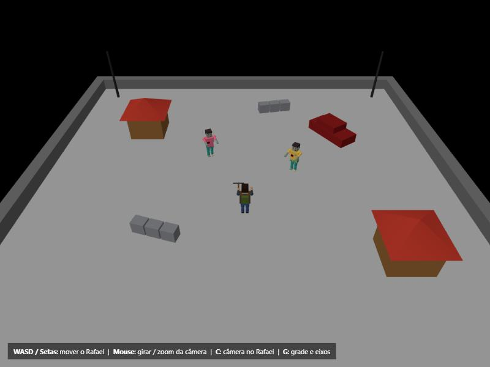
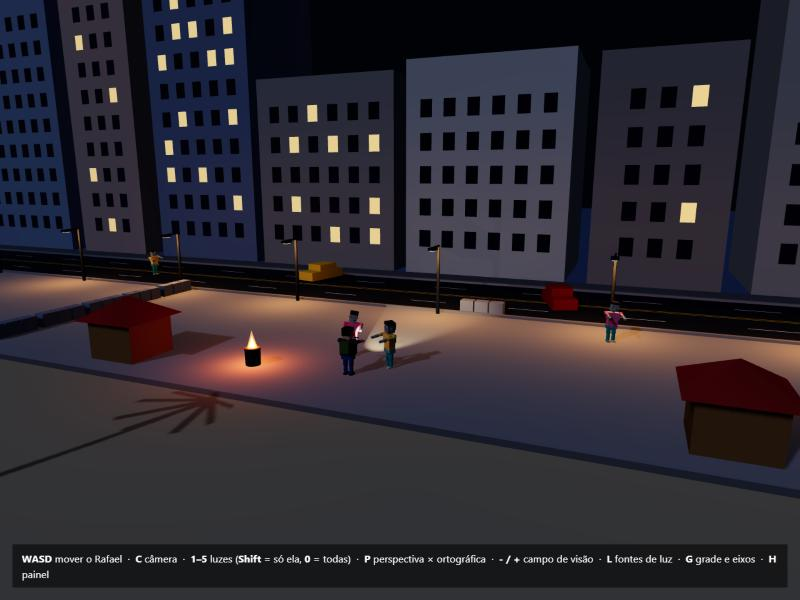
</p>

*À esquerda, a entrega 1. À direita, a mesma cena na entrega 2.*

| | Entrega 1 | Entrega 2 |
| --- | --- | --- |
| Cenário | Quadrado cinza de 32 × 32 m cercado por muro | Orla de Copacabana à noite: prédios, avenida, calçadão, areia, mar, morros e céu com estrelas |
| Objetos | Quiosque, carro, barricada e poste | Os mesmos objetos, agora em seus lugares na orla. O poste ganhou braço e luminária. Entram também coqueiros, um posto de salva-vidas e uma fogueira num tambor |
| Personagens | Rafael e dois zumbis, parados | Os mesmos modelos, sem alterações. São 7 zumbis espalhados pela orla, e todos andam |
| Câmera | Uma orbital e um atalho para perto do Rafael | Quatro câmeras com projeção perspectiva e uma ortográfica para comparação |
| Luz | Ambiente e direcional, sem sombra | Cinco fontes de quatro tipos diferentes, com sombra da lua e da lanterna |
| Interface | Barra de ajuda | Painel com as câmeras, a matriz de projeção e o controle de cada luz |

## 3. Cena 3D

A cena é a orla de Copacabana, onde acontece a primeira fase do jogo. É noite, e a cidade está quase sem energia, por isso só algumas janelas estão acesas. O eixo x acompanha a praia. Indo para −z ficam a avenida e os prédios; indo para +z ficam a areia e o mar.

- **Modelos da entrega 1:** o Rafael e as duas variações de zumbi (`src/personagens/`) são os mesmos arquivos. O quiosque, o carro, a barricada e o poste continuam com o mesmo código em `src/cenario/cenario.js`. O carro agora aceita cor, e o poste ganhou braço e luminária.
- **Coerência com a proposta:** as barricadas de concreto fecham o trecho do calçadão onde estão os sobreviventes, e a fogueira no tambor é deles. Carros abandonados ficam na avenida, e zumbis se espalham pela orla, inclusive do lado de fora das barricadas.
- **Profundidade:** os prédios, os postes e os coqueiros se repetem ao longo de 400 m de orla. Os morros ficam no fundo como silhuetas, e a névoa vai apagando o que está longe.

## 4. Câmeras

Todas as câmeras usam projeção perspectiva. A tecla **C** passa de uma para a outra, e os botões do painel levam direto a cada uma.

| Câmera | Posição | Campo de visão | Para que serve |
| --- | --- | --- | --- |
| Geral | Orbital (arrastar gira, roda aproxima) | 55° | Ver a cena inteira |
| 3ª pessoa | 7 m atrás e 4,5 m acima do Rafael, seguindo com suavidade | 60° | Acompanhar o personagem |
| 1ª pessoa | Nos olhos do Rafael (2,2 m) | 75° | A visão de quem joga, com a besta e a lanterna na frente |
| Posto 4 | Fixa no alto do posto de salva-vidas, olhando ao longo da orla | 42° | Mostrar o efeito da perspectiva |

<p>
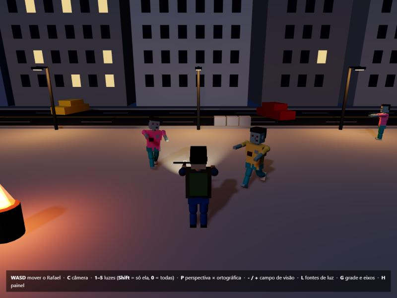
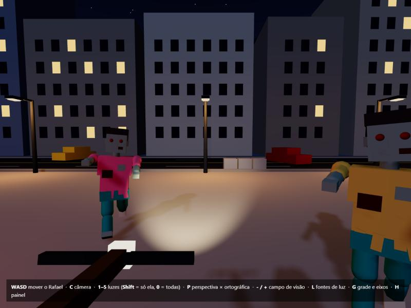
</p>
<p>

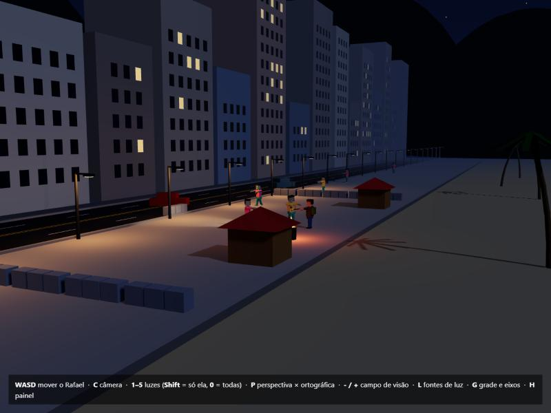
</p>

*Na ordem: 3ª pessoa, 1ª pessoa, Geral e Posto 4. A cena é a mesma, mas o ponto de vista muda.*

No código, as câmeras são criadas em `criarCameras()`, em `src/cameras.js`. A câmera usada a cada quadro vem de `cameras.camera`, que é a que vai para `renderer.render()`.

## 5. Projeção perspectiva

### Onde a matriz é definida

Em vez de usar a matriz pronta do three.js, montamos a nossa:

- **`matrizPerspectiva()`** (`src/cameras.js`, linha 19) monta a matriz a partir do campo de visão, do aspecto e dos planos perto e longe.
- **`CameraPerspectiva`** (`src/cameras.js`, linha 32) é uma `PerspectiveCamera` cujo `updateProjectionMatrix()` usa a nossa função para preencher `camera.projectionMatrix`. Esse método roda quando a câmera é criada, quando a janela muda de tamanho e quando o campo de visão muda.
- **`conferirComThree()`** (`src/cameras.js`, linha 41) compara a nossa matriz com a de `Matrix4.makePerspective` do three.js. O painel avisa "igual à do three.js" quando as duas batem.

Com f = 1 / tan(campo de visão / 2), a matriz é:

```
| f/aspecto   0    0                             0                          |
| 0           f    0                             0                          |
| 0           0    (longe+perto)/(perto-longe)   2·longe·perto/(perto-longe) |
| 0           0    -1                            0                          |
```

Na câmera do Posto 4 (campo de visão de 42°, aspecto 1,33, perto 0,1 e longe 700), f = 1 / tan(21°) = 2,605. A primeira linha fica com 2,605 / 1,33 = 1,954, e os dois números da terceira linha ficam com −1,000 e −0,200. São os mesmos valores que o painel mostra.

### Onde a matriz é aplicada

Em `src/main.js`, linha 187, o `renderer.render(scene, cameras.camera)` envia a `projectionMatrix` da câmera para o shader de vértice de cada material, que calcula `gl_Position = projectionMatrix * modelViewMatrix * vec4(position, 1.0)`. A última linha da matriz, (0, 0, −1, 0), faz w = −z, que é a distância até a câmera. Depois do shader, a GPU divide x e y por w: **quanto mais longe, maior o w, e menor o objeto na tela.**

### Demonstração com objetos perto e longe

Os postes da orla são todos iguais e ficam a cada 12 m. Na câmera do Posto 4, eles vão diminuindo até sumir no horizonte, e as linhas da avenida e da fachada se encontram num ponto de fuga.

O painel também mede, a cada quadro, a altura na tela de dois zumbis com o mesmo modelo (2,5 m de altura):

| Projeção | Zumbi perto | Zumbi longe |
| --- | --- | --- |
| Perspectiva | 46,2 m de profundidade → 54 px | 98,2 m de profundidade → 25 px |
| Ortográfica (comparação) | 54 px | 54 px |

Na perspectiva, o zumbi que está 2,13 vezes mais longe aparece 2,16 vezes menor, o que confirma que a altura na tela é proporcional a 1 / distância. Na ortográfica, a última linha da matriz vira (0, 0, 0, 1), não há divisão, e os dois ficam do mesmo tamanho. O controle de campo de visão também mostra o efeito: valores menores aproximam a cena como uma teleobjetiva, e valores maiores abrem a cena e exageram a perspectiva.

<p>
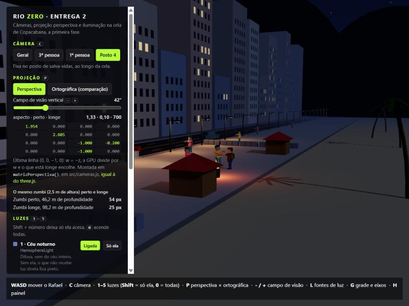
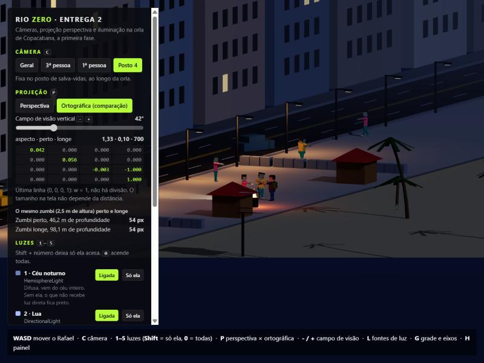
</p>

*Mesma câmera nas duas projeções: perspectiva à esquerda, ortográfica à direita.*

## 6. Iluminação

São cinco fontes de luz de quatro tipos diferentes, todas em `src/cenario/luzes.js`:

| # | Fonte | Tipo no three.js | Cor | Intensidade | Papel na cena |
| --- | --- | --- | --- | --- | --- |
| 1 | Céu noturno | `HemisphereLight` | Azul em cima, marrom embaixo | 0,55 | Luz difusa do céu. Sem ela, o que não recebe luz direta fica preto |
| 2 | Lua | `DirectionalLight` com sombra | Azul-claro | 0,75 | Raios paralelos que vêm do mar. Faz as sombras longas e o brilho na água |
| 3 | Postes da orla | 7 × `PointLight` | Laranja (sódio) | 60 cd, alcance de 24 m | Poças de luz quente no calçadão e na avenida |
| 4 | Fogueira | `PointLight` | Laranja forte | 28 cd, tremendo | Ilumina só por perto e oscila como fogo |
| 5 | Lanterna do Rafael | `SpotLight` com sombra | Branco quente | 90 cd, cone de 22° | Presa na besta, anda e gira junto com o Rafael |

Para identificar a contribuição de cada fonte, cada uma liga e desliga sozinha (teclas 1 a 5) ou fica acesa sozinha (Shift + número). Desligar zera a intensidade, mas a luz continua na cena, então o shader não precisa ser recompilado e a diferença aparece na hora. Cada fonte também tem um sinal visível que apaga junto: o disco da lua, as lâmpadas dos postes, as chamas e a lente da lanterna. A tecla L desenha onde fica cada uma.

<p>
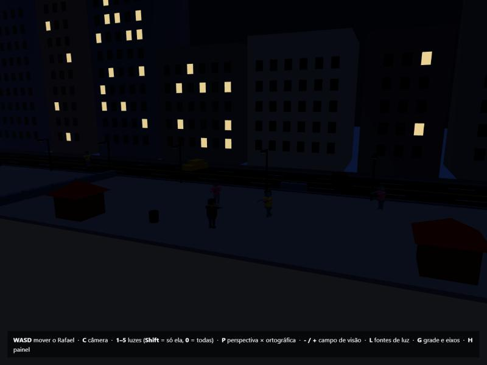
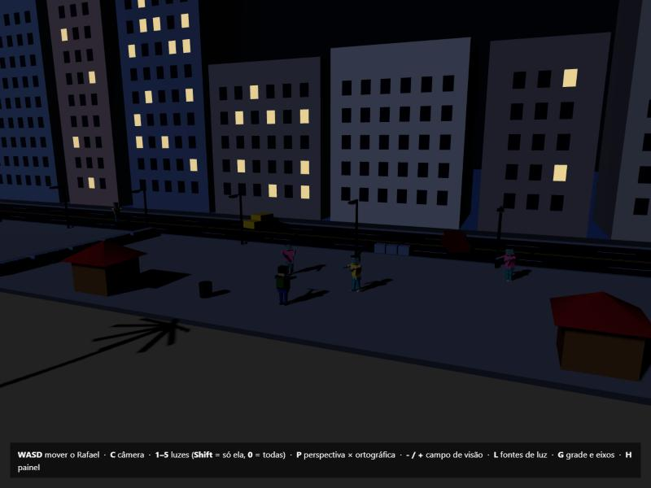
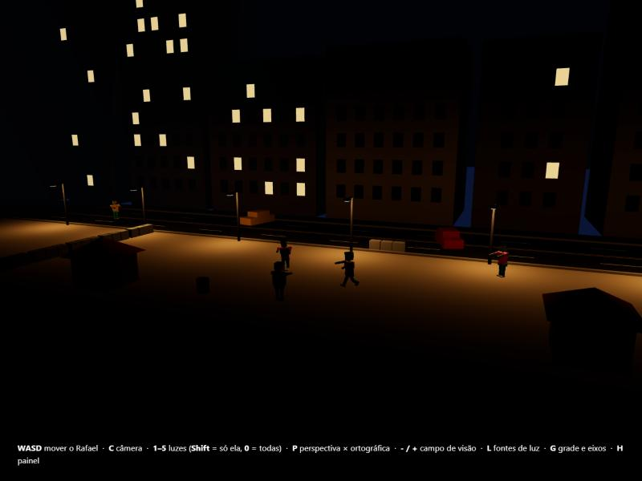
</p>
<p>
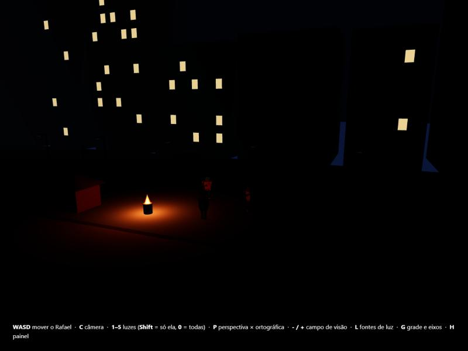
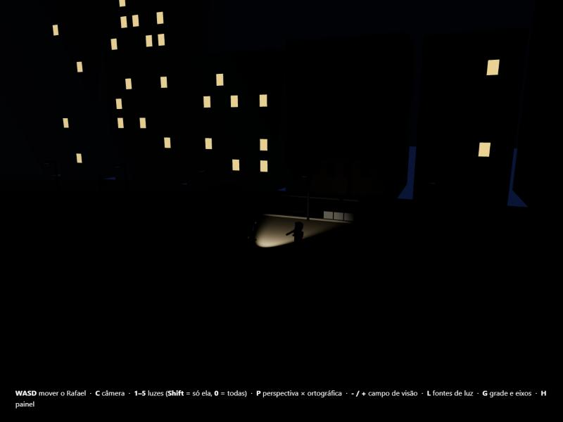

</p>

*Cada fonte acesa sozinha (céu, lua, postes, fogueira e lanterna). No último print, todas estão acesas e a tecla L marca onde cada uma fica. As janelas acesas dos prédios não são fontes de luz: são um material que brilha sozinho.*

## 7. Além do pedido

- **Personagens que andam:** a caminhada usa as articulações que já existiam no modelo da entrega 1 (quadril, joelhos, tronco e cabeça). O Rafael anda segurando a besta firme, e os zumbis cambaleiam, com o corpo pendendo para os lados (`src/personagens/movimento.js`).
- **Zumbis com comportamento:** eles vagam perto de onde estão e, quando o Rafael chega a menos de 12 m, viram e vão atrás dele. Param a 2,4 m e não atravessam as barricadas. Ainda não atacam; o ataque entra junto com o combate.
- **Ambiente:** sombras da lua e da lanterna, névoa, céu em degradê com estrelas e mar com ondas, que mudam o brilho da lua na água.

## 8. Arquivos desta entrega

| Arquivo | Situação |
| --- | --- |
| `src/main.js` | Reescrito: monta a cena, lê as teclas, move o Rafael e chama o laço de desenho |
| `src/cameras.js` | Novo: as quatro câmeras, a matriz de projeção e a comparação ortográfica |
| `src/cenario/cenario.js` | Ampliado: a orla inteira, mantendo os objetos da entrega 1 |
| `src/cenario/luzes.js` | Novo: as cinco fontes de luz e o liga e desliga |
| `src/painel.js` | Novo: o painel da demonstração |
| `src/personagens/movimento.js` | Novo: caminhada e comportamento dos zumbis |
| `src/teclado.js` | Pequena mudança: reconhece Shift + tecla |
| `src/personagens/Humanoide.js`, `Rafael.js`, `Zumbi.js` | Sem mudança |
| `index.html`, `style.css` | Painel e nova barra de ajuda |

Na próxima etapa entram as texturas dos materiais (o calçadão de ondas pretas e brancas, o asfalto e a areia) e o começo do combate.
