# Rio Zero · Entrega 3: texturas e mapeamento UV

Computação Gráfica · UNIFESP · 12 de novembro de 2026

| Integrante | RA |
| --- | --- |
| Felipe Pinto Zanata | 176287 |
| Davi Gonçalves Friggi | 176479 |
| João Pedro Soldera Snabaitis Markues | 176531 |
| João Pedro Navarro Okita | 176530 |
| João Pedro Carneiro da Costa | 176528 |
| Guilherme Pombo Takayama Augusto | 176500 |

## 1. Como executar

O projeto continua precisando de um servidor local, por causa dos módulos ES e das imagens de textura:

```bash
python -m http.server 8000
```

Depois, abra `http://localhost:8000`. As teclas das entregas anteriores continuam valendo. Estas são as novas:

| Tecla | O que faz |
| --- | --- |
| **T** | Liga e desliga as texturas (sem textura, cada objeto fica com a cor média da sua imagem) |
| **U** | Troca todas as texturas pela grade UV, para conferir o mapeamento |
| **Espaço**, ou clique na 1ª e 3ª pessoa | Dispara a besta |
| **R** | Recomeça (o Rafael volta à posição inicial e os zumbis renascem) |

O painel agora tem três abas: **Texturas** (os modos, os objetos e as coordenadas UV de cada um), **Câmeras** (a demonstração da entrega 2) e **Luzes**.

## 2. O que mudou desde a entrega 2

<p>
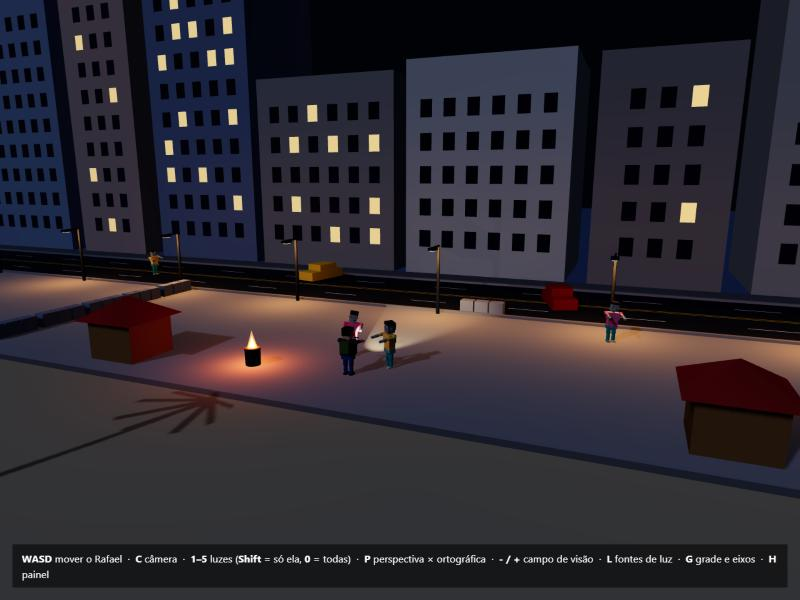
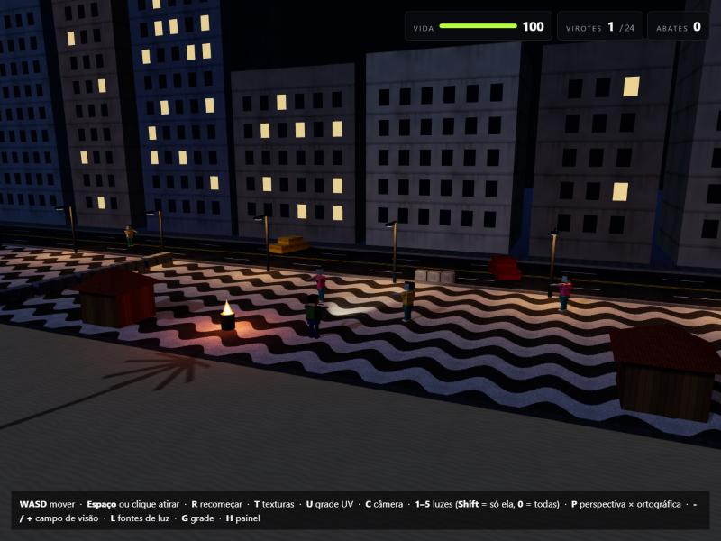
</p>

*À esquerda, a entrega 2. À direita, a mesma câmera na entrega 3.*

| | Entrega 2 | Entrega 3 |
| --- | --- | --- |
| Texturas | Nenhuma: só cores lisas | 15 texturas de cor, 2 mapas de relevo e a grade UV, em 18 arquivos de imagem |
| Coordenadas UV | As que cada geometria do three.js traz | Recalculadas em metros, para nenhuma textura esticar |
| Personagens | Bonecos de caixa com cores lisas | Os mesmos bonecos, com rosto, jaqueta de couro, jeans, malha e camisa rasgada |
| Iluminação | Cinco fontes de luz | As mesmas cinco, agora iluminando as texturas, e com relevo no calçadão e nas barricadas |
| Jogo | Os zumbis andam e perseguem o Rafael | Começo do combate: a besta dispara, os zumbis levam dano e caem, o Rafael tem vida e há um HUD |

## 3. As texturas

Todas as imagens foram desenhadas por nós, com o script `ferramentas/gerar_texturas.py` (em Python, com numpy e Pillow). Nenhuma é foto ou arte de terceiros. As que cobrem superfícies grandes usam ruído periódico, então a borda da direita continua na da esquerda e a de cima continua na de baixo. Assim a imagem se repete pelo objeto sem deixar costura.

<p>
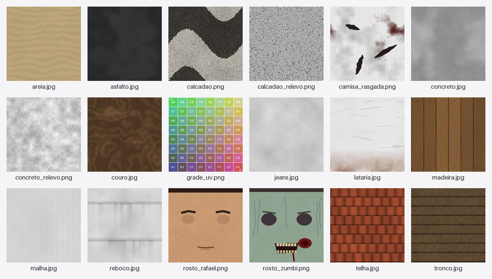
</p>

Algumas texturas são em cinza e recebem a cor do material. Com uma só imagem de lataria saem carros vermelhos, amarelos e azuis, e com um só jeans saem a calça azul do Rafael e a verde-água dos zumbis.

| Arquivo | Pixels | Onde é usada | Uma imagem cobre | Cor |
| --- | --- | --- | --- | --- |
| `calcadao.png` | 512 | Calçadão (ondas de pedras portuguesas pretas e brancas) | 3 m | Própria |
| `calcadao_relevo.png` | 512 | Relevo do calçadão: rejunte fundo e pedras abauladas | 3 m | Altura |
| `asfalto.jpg` | 512 | Avenida | 4 m | Própria |
| `areia.jpg` | 512 | Areia e areia molhada | 3 m | Própria (tingida na molhada) |
| `reboco.jpg` | 512 | Fachadas dos prédios | 6,4 m | Tingida pela cor de cada prédio |
| `concreto.jpg` | 256 | Barricadas, meio-fio e calçada dos prédios | 1 m | Tingida |
| `concreto_relevo.png` | 256 | Relevo das barricadas | 1 m | Altura |
| `madeira.jpg` | 512 | Quiosques, cabine do posto e coronha da besta | 1,5 m | Própria |
| `telha.jpg` | 256 | Telhados dos quiosques e do posto | 1 m | Própria |
| `lataria.jpg` | 256 | Carros e tambor da fogueira | 2 m | Tingida pela cor do carro |
| `tronco.jpg` | 256 | Coqueiros | 1 m | Própria |
| `jeans.jpg` | 256 | Calças do Rafael e dos zumbis | 0,5 m | Tingida |
| `couro.jpg` | 256 | Jaqueta do Rafael | 0,5 m | Própria |
| `malha.jpg` | 256 | Camisa, faixa e mochila do Rafael | 0,5 m | Tingida |
| `camisa_rasgada.png` | 256 | Camisas dos zumbis | 0,6 m | Tingida (rosa ou amarela) |
| `rosto_rafael.png` | 256 | Frente da cabeça do Rafael | A face inteira | Própria |
| `rosto_zumbi.png` | 256 | Frente da cabeça dos zumbis | A face inteira | Própria |
| `grade_uv.png` | 512 | Só na demonstração (tecla U) | — | Própria |

No código, `carregarTexturas()` (`src/texturas.js`) carrega as imagens com o `TextureLoader` do three.js antes de montar a cena. Ele marca cada uma para repetir (`RepeatWrapping`), aplica o espaço de cor sRGB nas imagens de cor e usa filtragem anisotrópica, para o chão não borrar quando é visto de lado. Cada material texturizado é um `MeshLambertMaterial` com a imagem em `map` e, no calçadão e nas barricadas, o relevo em `bumpMap`.

## 4. Mapeamento: as coordenadas UV

Cada vértice de um modelo guarda um par (u, v), que indica qual ponto da imagem cai sobre ele. Dentro de cada triângulo, a GPU interpola o (u, v) entre os três vértices e lê a cor da imagem naquele ponto. Como as texturas repetem, u = 2,5 significa a metade da terceira cópia da imagem.

### O problema das coordenadas padrão

As geometrias do three.js vêm com u e v indo de 0 a 1 em cada face. Isso estica a imagem para o tamanho de cada face: o calçadão de 420 m teria uma onda só, e a mesma textura de concreto ficaria com pedrinhas de tamanhos diferentes num bloco de 1 m e num meio-fio de 420 m.

### A solução: UV em metros

A função `uvEmMetros(geometria, metros)` (`src/texturas.js`) recalcula o UV de cada vértice. Ela olha para que lado a face aponta (a normal) e usa as duas coordenadas da posição que ficam "deitadas" naquela face, divididas pelo tamanho que uma imagem deve cobrir:

```
face virada para ±x:  u = ∓z / metros,  v = y / metros
face virada para ±z:  u = ±x / metros,  v = y / metros
face virada para ±y:  u =  x / metros,  v = ∓z / metros
```

Com isso, uma imagem cobre sempre o mesmo pedaço do mundo, e um quadrado da imagem continua quadrado no objeto. As faces laterais ficam com o v para cima, então nenhuma textura aparece de cabeça para baixo.

Algumas peças pedem outro tratamento:

- **Cilindros, cones e cápsulas** já vêm com o u dando a volta e o v percorrendo o comprimento. A função `escalarUV()` só multiplica u pelo perímetro e v pelo comprimento, os dois divididos pelos metros da textura.
- **Cabeça:** usa o UV padrão da caixa, de 0 a 1, porque o rosto é uma imagem só e deve cobrir a face inteira. A caixa recebe uma lista de seis materiais, e só a face da frente (+z) leva a textura do rosto.
- **Prédios:** a caixa foi deslocada para começar no chão. Assim o y local é a altura de verdade, e as faixas das lajes na textura, a cada 3,2 m, caem entre as janelas em todos os prédios.

| Objeto | Geometria | Como o UV é calculado | Faixa de u | Faixa de v |
| --- | --- | --- | --- | --- |
| Calçadão | Plano de 420 × 20 m | u = x ÷ 3 m, v = y ÷ 3 m | −70 a 70 | −3,33 a 3,33 |
| Barricada | Caixa de 1 × 0,9 × 0,8 m | Por face, dividido por 1 m | −0,5 a 0,5 | −0,45 a 0,45 |
| Telhado | Cone de 4 lados | u × 4 × 3,96 m, v × 3,05 m | 0 a 15,84 | 0 a 3,05 |
| Tronco | Cilindro de 7 lados | u × perímetro, v × 1,6 m | 0 a 1,26 | 0 a 1,6 |
| Calça (coxa) | Cápsula | u × perímetro ÷ 0,5 m, v × comprimento ÷ 0,5 m | 0 a 1,63 | 0 a 1,08 |
| Rosto | Face da frente de uma caixa | Padrão | 0 a 1 | 0 a 1 |

### Demonstração do mapeamento

Na aba Texturas, cada objeto da lista leva a câmera até ele e desenha as coordenadas UV dos triângulos que usam aquela imagem por cima dela. As linhas tracejadas marcam onde a imagem se repete.

<p>
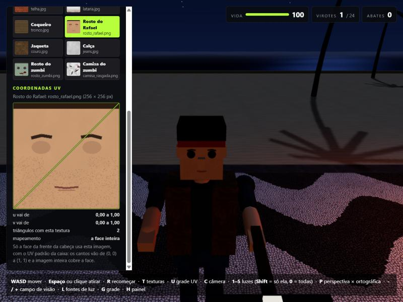
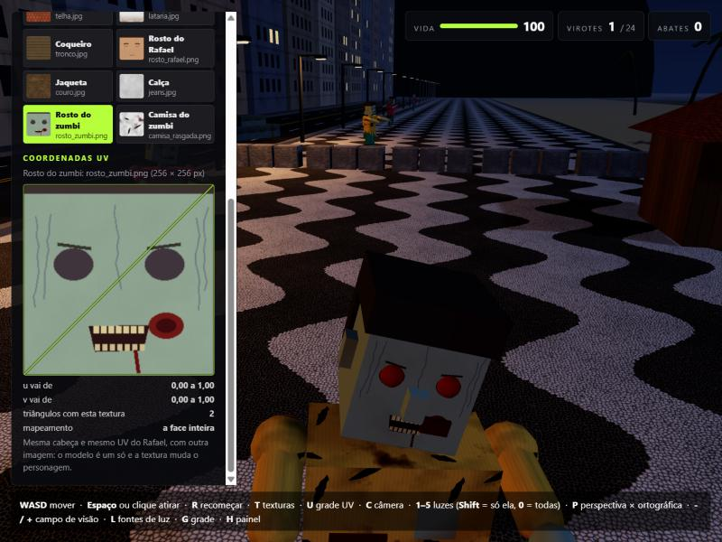
</p>

*O rosto ocupa a imagem inteira: dois triângulos com os cantos em (0, 0) e (1, 1). O zumbi usa a mesma cabeça e o mesmo UV, só que com outra imagem.*

<p>
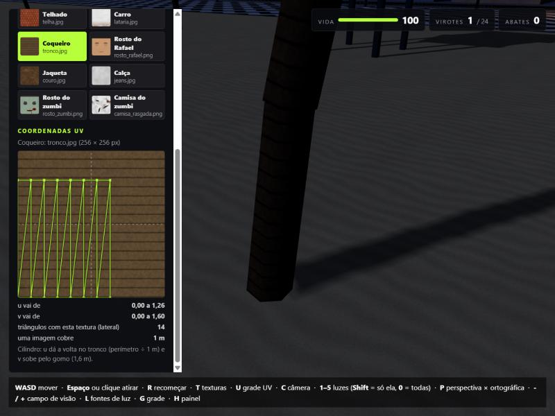
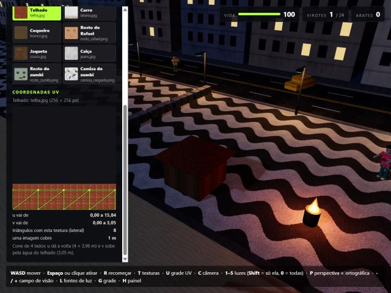
</p>

*No cilindro do tronco, cada coluna é um dos 7 lados, e os anéis da imagem dão a volta no tronco. No cone do telhado, os 4 lados formam uma faixa de 15,84 × 3,05 repetições da telha.*

<p>
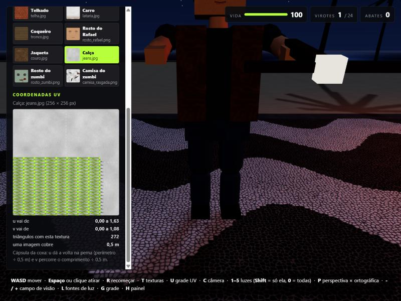
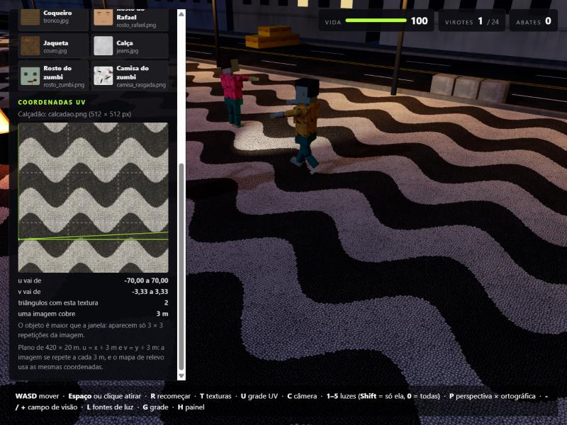
</p>

*A cápsula da coxa tem 272 triângulos dentro de 1,63 × 1,08 repetições do jeans. O plano do calçadão é enorme, então o painel mostra só um trecho de 3 × 3 repetições.*

A tecla **U** troca todas as texturas pela grade UV, em que cada quadrado é 1/8 da imagem. Se o mapeamento estica, os quadrados ficam retangulares ou tortos. Aqui eles ficam do mesmo tamanho em cada tipo de superfície, com 37,5 cm no calçadão e 12,5 cm nas barricadas.

<p>
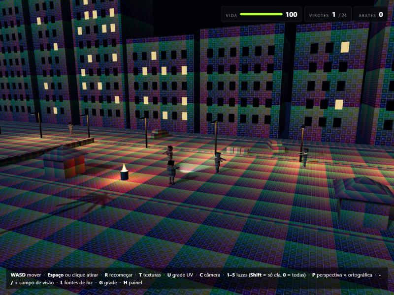
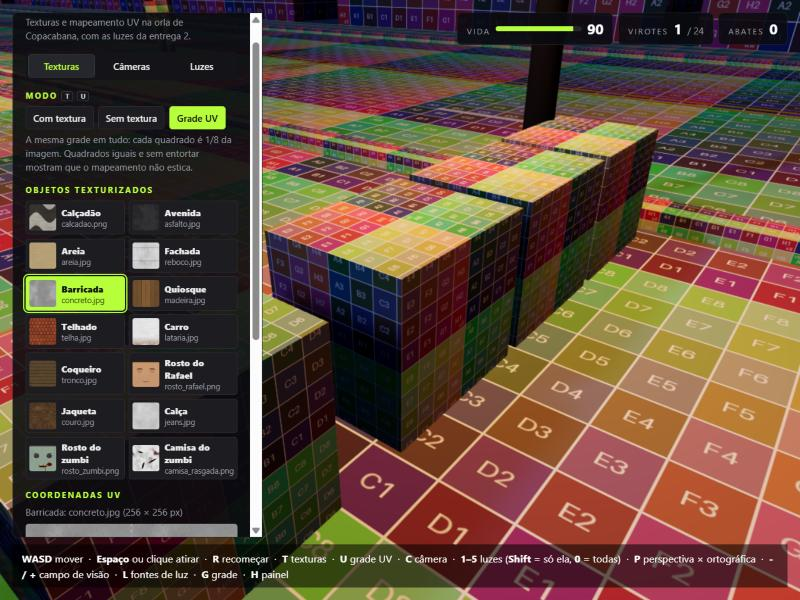
</p>
<p>
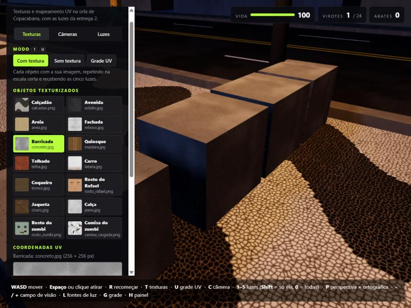
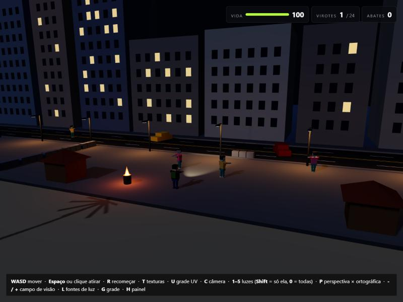
</p>

*A grade na cena inteira e nas barricadas, as mesmas barricadas com a textura de concreto, e a cena sem textura (tecla T).*

## 5. Integração com a iluminação

As cinco fontes de luz da entrega 2 continuam iguais: céu, lua, postes, fogueira e lanterna. No `MeshLambertMaterial`, a cor final de cada ponto é a cor da textura naquele (u, v), multiplicada pela cor do material e pela luz difusa que chega ali. A luz que chega depende do ângulo entre a superfície e cada fonte. Por isso a mesma pedra do calçadão fica laranja perto da fogueira, amarelada sob os postes e azulada sob a lua.

No calçadão e nas barricadas, o mapa de relevo (`bumpMap`) muda a normal de cada pixel conforme a altura desenhada na imagem. O rejunte entre as pedrinhas e os poros do concreto ficam mais escuros onde a luz bate de lado, como na lanterna passando pelo chão.

<p>
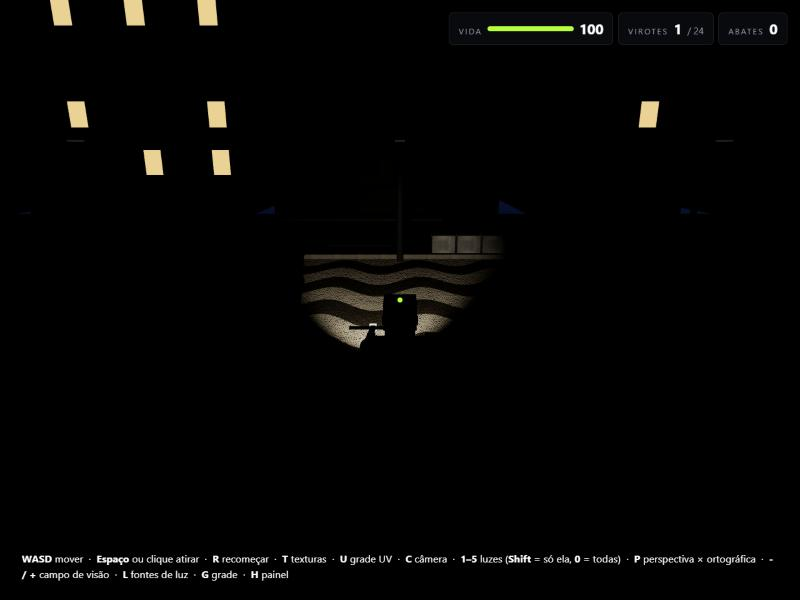
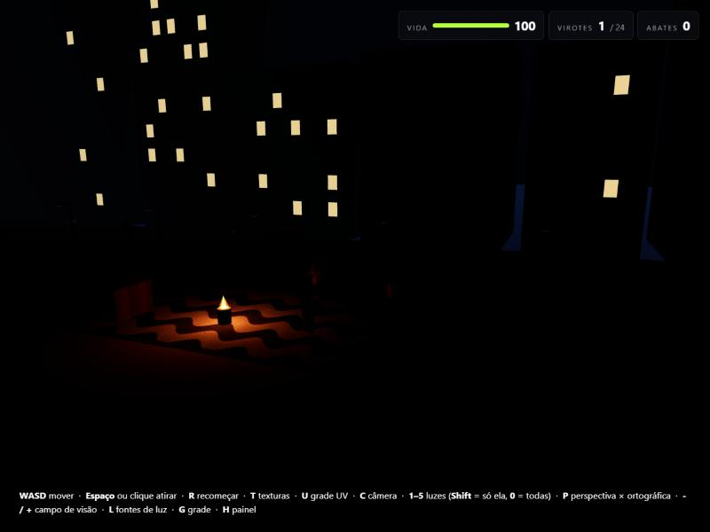
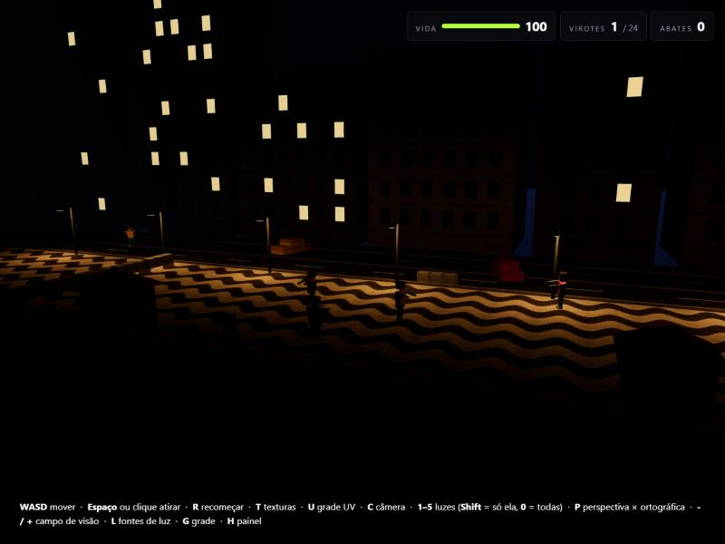
</p>

*Cada fonte sozinha sobre as texturas: a lanterna recorta um cone de calçadão no escuro, a fogueira deixa as ondas laranja por perto, e os postes formam poças de luz quente ao longo da orla. As janelas acesas não são fontes de luz: são um material que brilha sozinho.*

## 6. Além do pedido: o começo do combate

- **Besta:** Espaço, ou clique na 1ª e 3ª pessoa, dispara um virote a 48 m/s, com um pouco de gravidade. Cada acerto tira 70 de vida, e na cabeça tira o dobro. O zumbi pisca em vermelho, é empurrado para trás e cai de costas com dois acertos no corpo ou um na cabeça. Depois afunda no chão e renasce longe do Rafael.
- **Munição:** um virote carregado e 24 na aljava, com 1,05 s de recarga. O virote que erra fica cravado no chão e volta para a aljava quando o Rafael passa por cima.
- **Zumbis:** continuam vagando até perceberem o Rafael, o que acontece quando ele encosta neles, quando atira a menos de 14 m ou quando acerta um deles. Aí vão atrás dele e atacam, tirando 10 de vida a cada 1,3 s.
- **Rafael:** tem 100 de vida, que volta aos poucos depois de 4 s sem apanhar. Quando a vida acaba, ele cai, e a tecla R recomeça.
- **HUD:** mostra a vida, os virotes e os abates. Também tem a mira nas câmeras de 1ª e 3ª pessoa e a borda da tela piscando em vermelho quando o Rafael apanha.

<p>
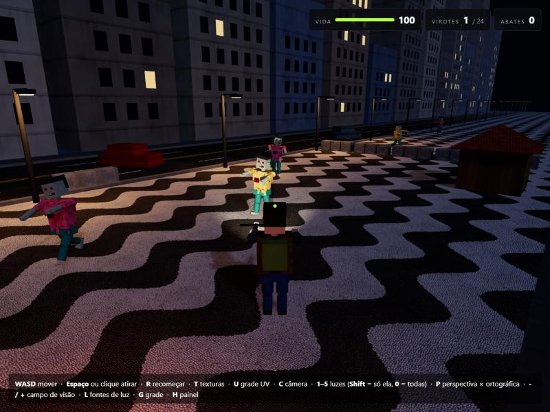
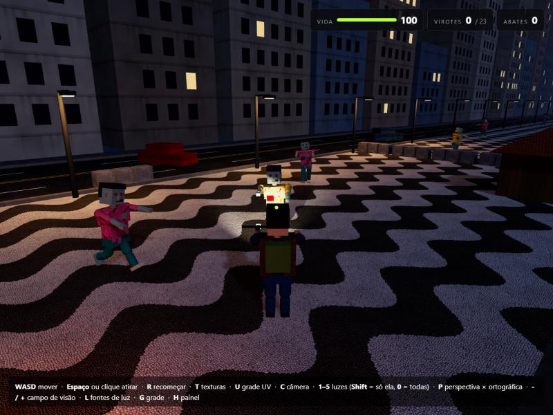
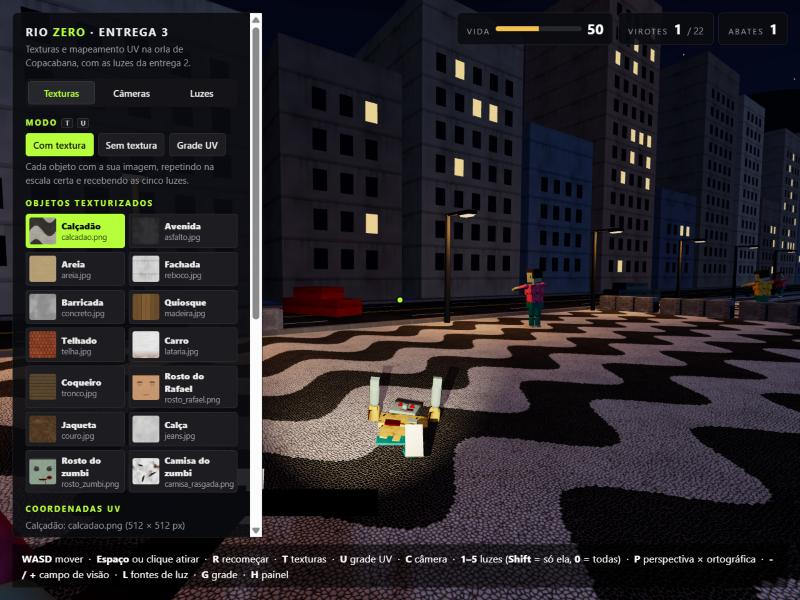
</p>

## 7. Arquivos desta entrega

| Arquivo | Situação |
| --- | --- |
| `texturas/` | Novo: os 18 arquivos de imagem |
| `ferramentas/gerar_texturas.py` | Novo: o script que desenha as texturas |
| `src/texturas.js` | Novo: carrega as imagens, calcula o UV em metros e troca os modos (com textura, sem textura e grade UV) |
| `src/combate.js` | Novo: a besta, os virotes e a vida do Rafael |
| `src/hud.js` | Novo: vida, virotes, abates, mira e aviso de queda |
| `src/cenario/cenario.js` | Texturas no chão, nos prédios e nos objetos |
| `src/personagens/Humanoide.js`, `Rafael.js` e `Zumbi.js` | Rosto e roupas texturizados; o formato dos bonecos não mudou |
| `src/personagens/movimento.js` | Zumbis que percebem o Rafael, atacam, caem e renascem |
| `src/painel.js` | Painel em três abas, com a lista de objetos e o desenho das coordenadas UV |
| `src/cameras.js` | A câmera geral pode ir até um objeto escolhido no painel |
| `src/main.js`, `index.html` e `style.css` | Carregamento das texturas, novas teclas e o estilo do painel e do HUD |

Na próxima etapa entram o corpo dos personagens com formas arredondadas e a primeira fase completa, com ondas de zumbis e pontuação.
