# Rio Zero · Entrega 4: jogabilidade, interação e pontuação

Computação Gráfica · UNIFESP · 19 de novembro de 2026

| Integrante | RA |
| --- | --- |
| Felipe Pinto Zanata | 176287 |
| Davi Gonçalves Friggi | 176479 |
| João Pedro Soldera Snabaitis Markues | 176531 |
| João Pedro Navarro Okita | 176530 |
| João Pedro Carneiro da Costa | 176528 |
| Guilherme Pombo Takayama Augusto | 176500 |

## 1. Como executar

Como nas entregas anteriores, o projeto precisa de um servidor local:

```bash
python -m http.server 8000
```

Depois, abra `http://localhost:8000` e clique em **Jogar** (ou aperte Enter). O clique na tela prende o mouse, que passa a controlar o olhar. **Esc** solta o mouse e pausa.

| Tecla | O que faz |
| --- | --- |
| **W A S D** | Andar na direção do olhar |
| **Mouse** | Olhar e mirar |
| **Clique esquerdo** | Disparar |
| **Clique direito** (segurar) | Mirar pela arma (o campo de visão fecha e o tiro fica mais preciso) |
| **Espaço** | Pular |
| **Shift** ou **C** | Agachar. Correndo, desliza, e o deslize é a esquiva |
| **F** | Empurrar com a coronha |
| **R** | Recarregar |
| **1**, **2**, **Q** ou rodinha | Trocar entre a besta e a pistola |
| **C** (jogando) | Alternar entre a 1ª e a 3ª pessoa |
| **M** | Liga e desliga o som |
| **Esc** | Pausa (Enter continua, R recomeça) |
| **H** | Modo apresentação: para o jogo e abre o painel das entregas 2 e 3 |

No **modo apresentação** (tecla H), o mundo congela, aparece um zumbi parado na frente do Rafael e voltam todas as teclas de demonstração das entregas anteriores: câmeras (C), projeção perspectiva ou ortográfica (P), campo de visão (- e +), luzes (1 a 5, 0 e L), texturas (T), grade UV (U) e grade de 1 m (G). Apertar H de novo volta ao jogo, pausado.

## 2. A mudança de direcionamento

Antes de começar esta entrega, o grupo se reuniu para decidir como o jogo seria jogado, já que a jogabilidade é o tema desta etapa. A decisão, tomada pelo grupo em conjunto, foi mudar o estilo de combate da proposta inicial.

### O que a proposta previa

A proposta descrevia um jogo de ação com **tiro automático**, no estilo de *Archero*: a câmera ficaria acima do personagem, o jogador só andaria, e o personagem atiraria sozinho no zumbi mais próximo sempre que parasse. As fases seriam **arenas fixas e fechadas**, cada uma num ponto turístico do Rio.

### O que decidimos fazer

O Rio Zero passa a ser um **jogo de tiro em primeira pessoa com mira manual**. O jogador vê pelos olhos do Rafael, mira com o mouse e decide cada disparo. A orla de Copacabana continua sendo o cenário, mas agora é uma área aberta, com zumbis chegando pela avenida, pelo mar e pelas pontas da praia, e com **ninhos** que brotam na areia e soltam mais zumbis até serem destruídos.

| | Proposta inicial | Direção atual |
| --- | --- | --- |
| Câmera de jogo | De cima, seguindo o personagem | 1ª pessoa, com as mãos e a arma na tela. A 3ª pessoa continua na tecla C |
| Tiro | Automático, no zumbi mais próximo, quando o jogador para | Manual: o jogador mira e dispara. Tiro na cabeça vale o dobro |
| Movimento | Andar para desviar | Andar, pular, agachar e deslizar. O deslize é a esquiva |
| Armas | Uma arma que melhora com o tempo | Besta (silenciosa, virotes contados) e pistola (barulhenta, munição sem fim) |
| Fase | Arena fechada com ondas | Área aberta da orla com três ondas e ninhos |
| Desafio | Desviar dos ataques | Ler o aviso do golpe, controlar o barulho e cuidar da munição |

### Por que mudamos

1. **O trabalho das entregas 2 e 3 rendia mais de perto.** Nas entregas anteriores construímos a orla, a iluminação e as texturas olhando de dentro da cena: a câmera em 1ª pessoa, a lanterna e o relevo do calçadão só aparecem de verdade nessa altura. Com a câmera de cima, quase tudo isso viraria um chão visto de longe. Um dos pilares do jogo é "o Rio como personagem", e ele fica mais presente na altura dos olhos.
2. **O tema desta entrega pede ações do jogador.** Com tiro automático, "atacar" e "disparar" não seriam decisões do jogador. Com a mira manual, cada ação pedida (pular, atacar, desviar, coletar e disparar) tem uma tecla e uma consequência.
3. **A interação fica mais rica.** Em primeira pessoa faz sentido o zumbi enxergar num cone à frente, ouvir o tiro a certa distância e avisar o golpe antes de bater. Isso cria regras que o jogador consegue ler e usar, como trocar a pistola pela besta para não chamar atenção.
4. **A base já estava pronta.** A entrega 2 já tinha a câmera em 1ª pessoa, e a entrega 3 já tinha a besta disparando virotes com física. A mudança aproveitou o que existia em vez de jogar fora.

O enredo, os personagens, o cenário e a ordem das fases não mudaram. O Rafael continua sendo um ex-atleta de tiro com arco, por isso a besta é a arma principal.

### O que mudou também por isso

- **Organização do código.** Para crescer até o jogo completo, o código passou a ser dividido por função, em pastas: `core/` (entrada, câmeras e som), `entities/` (personagens, armas, ninhos e projéteis), `systems/` (ondas), `scenes/` (a fase), `data/` (números do jogo), `ui/` (HUD e painel) e `world/` (cenário, luzes, texturas, colisão e efeitos).
- **Proporções.** O Rafael e os zumbis foram reduzidos para cerca de 1,90 m, a altura certa para a câmera em 1ª pessoa ficar nos olhos (1,65 m) e o cenário ter a escala de uma rua de verdade.
- **Teclas.** Espaço deixou de disparar e passou a pular, e R deixou de recomeçar e passou a recarregar, como na maioria dos jogos de tiro. As teclas das entregas anteriores não sumiram: estão todas no modo apresentação (H).

## 3. O que mudou desde a entrega 3

<p>
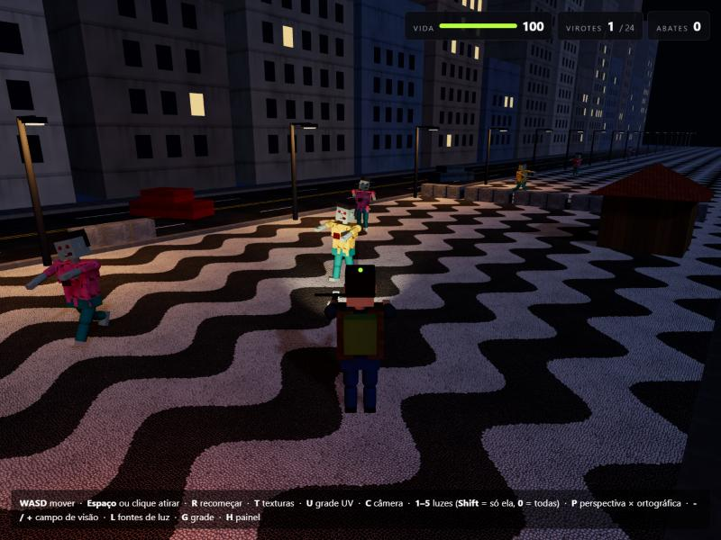
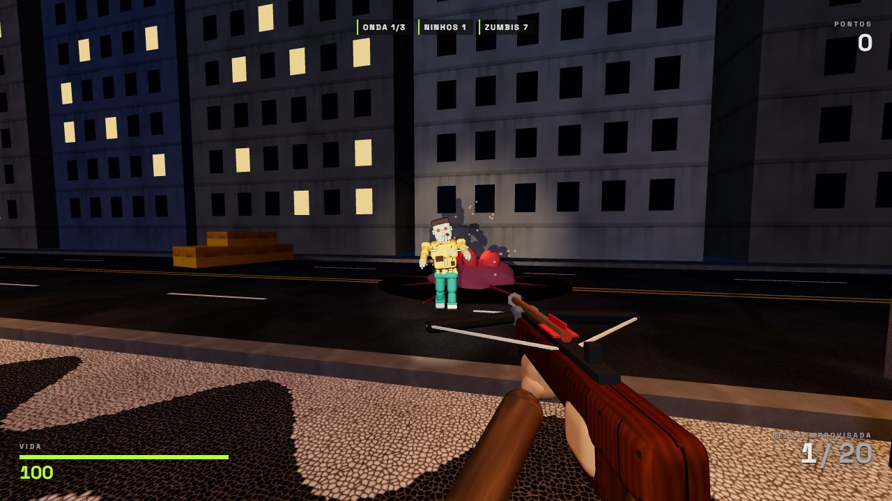
</p>

*À esquerda, o começo do combate na entrega 3. À direita, o jogo nesta entrega.*

| | Entrega 3 | Entrega 4 |
| --- | --- | --- |
| Jogo | Uma cena para explorar, com zumbis que renascem sem parar | Uma partida com começo, três ondas, vitória ou derrota e reinício |
| Câmera | Quatro câmeras de demonstração | 1ª pessoa com mãos e arma, 3ª pessoa por cima do ombro, e as de demonstração no modo apresentação |
| Ações | Andar e disparar a besta | Andar, pular, agachar, deslizar, disparar, mirar, recarregar, trocar de arma, empurrar e recolher virotes |
| Armas | Besta | Besta e pistola, cada uma com pente, recarga, coice e som |
| Zumbis | Percebiam o Rafael pela distância | Enxergam num cone, ouvem os tiros, gritam para os outros e avisam o golpe |
| Colisão | Nenhuma: o Rafael atravessava o cenário | O corpo bate em quiosques, carros, barricadas, postes e coqueiros, e dá para subir nas barricadas |
| Pontuação | Contador de abates | Pontos, combo, recorde e resumo da partida |
| Vida | Voltava sozinha depois de 4 s | Não volta: cada golpe pesa até o fim |
| Interface | Vida, virotes e abates | Menu, HUD completo, pausa e telas de vitória e de derrota |
| Som | Nenhum | Tiros, passos, zumbis, ninhos, música de ondas e ambiente do mar, tudo gerado em código |
| Código | 2,4 mil linhas em 13 arquivos | 5,2 mil linhas em 25 arquivos, organizados em pastas |

## 4. Movimento e controles

O Rafael é controlado em primeira pessoa (`src/entities/Player.js`). O mouse gira o olhar: o movimento horizontal muda o ângulo de guinada (*yaw*) e o vertical muda a inclinação (*pitch*), limitada a ±83° (1,45 rad) para a câmera não virar. As teclas W A S D formam um vetor de direção relativo ao olhar, girado pelo *yaw*:

```
frente = (-sen yaw, 0, -cos yaw)     lado = (cos yaw, 0, -sen yaw)
direção desejada = normalizar(frente × (W - S) + lado × (D - A))
```

O movimento tem aceleração e atrito, em vez de mudar a posição direto: a velocidade cresce até 7,5 m/s em uma fração de segundo e freia rápido quando a tecla é solta. No ar, o controle é bem menor, então o pulo tem trajetória. A gravidade é de 24 m/s² e o pulo sai a 8,2 m/s, o que dá cerca de 1,4 m de altura, o bastante para subir nas barricadas.

A altura dos olhos acompanha a postura: 1,65 m em pé, 1,10 m agachado e 0,95 m deslizando, sempre com uma transição suave. Mirar com o botão direito fecha o campo de visão (de 78° para 46° na besta e 60° na pistola) e deixa o movimento e o mouse mais lentos.

<p>
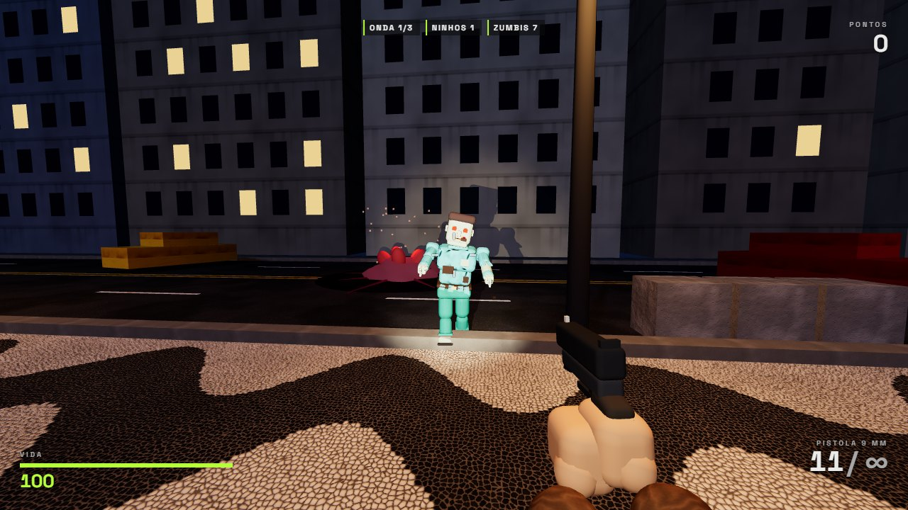
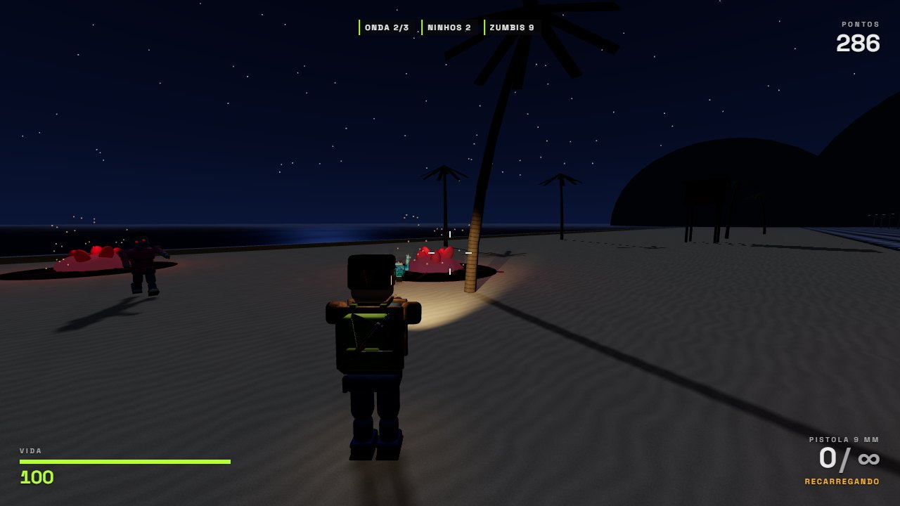
</p>

*À esquerda, a pistola na mão e o rastro do tiro. À direita, a 3ª pessoa (tecla C), com a câmera por cima do ombro.*

### A arma na tela

As mãos e a arma (`src/entities/Arma.js`) são modelos 3D presos na câmera de 1ª pessoa, desenhados numa camada própria (`layers`) que só essa câmera enxerga. Na 3ª pessoa, a câmera vê o corpo do Rafael com a arma na mão, e as mãos da 1ª pessoa somem. Cada arma balança com o passo, acompanha o movimento do mouse com um pequeno atraso, recua no tiro e tem animação de recarga: na besta, a corda volta a esticar e o virote aparece no trilho; na pistola, o ferrolho corre.

## 5. As ações

| Ação | Tecla | O que acontece |
| --- | --- | --- |
| **Pular** | Espaço | O Rafael sobe, cai pela gravidade e pode parar em cima das barricadas. Ao cair, faz o som do pouso, mais forte quanto maior a queda |
| **Atacar** | F | Empurrão com a coronha: tira 8 de vida e joga para trás os zumbis a até 2,1 m, à frente do Rafael. Se o zumbi estava com os braços erguidos para bater, o golpe dele é cancelado |
| **Desviar** | Shift correndo | Desliza por 0,75 s com um embalo para a frente e a câmera baixa. O golpe de um zumbi durante o deslize passa por cima (esquiva, +5 pontos) |
| **Coletar** | Passar por cima | Virotes cravados no chão ou caídos de um zumbi derrubado voltam para a aljava a até 1,4 m do Rafael |
| **Disparar** | Clique esquerdo | Besta: virote com velocidade e gravidade, que voa até acertar. Pistola: tiro instantâneo, com rastro de luz |

As duas armas se completam:

| | Besta | Pistola |
| --- | --- | --- |
| Dano | 70 (140 na cabeça): derruba um Caminhante com um virote | 24 (48 na cabeça): três tiros no corpo, dois na cabeça |
| Cadência | Um virote por vez, 1,05 s para recarregar | Pente de 12, 0,15 s entre os tiros, 1,3 s para recarregar |
| Munição | 20 virotes para começar, até 30. O que não for recolhido faz falta | Sem fim |
| Barulho | Ouvida a 7 m | Ouvida a 26 m: acorda os zumbis por perto |
| Disparo | Projétil: sai a 70 m/s e cai com a gravidade | Instantâneo (*hitscan*), até 70 m |

## 6. Interações por colisão e proximidade

Todas as interações do jogo são calculadas por colisão ou por distância:

| Interação | Como é calculada |
| --- | --- |
| **Rafael com o cenário** | O corpo é um círculo de 0,45 m no chão. A cada quadro, ele é empurrado para fora das caixas de colisão de quiosques, carros, barricadas, postes e coqueiros (`src/world/colisao.js`). Obstáculos mais baixos que os pés não empurram, então dá para andar em cima da barricada |
| **Tiro com zumbis** | Um `Raycaster` do three.js traça o segmento do tiro contra as malhas dos zumbis próximos da linha. Se o ponto atingido pertence à cabeça, é tiro na cabeça |
| **Virote em voo** | A cada quadro, o virote anda pela velocidade e cai pela gravidade, e o trecho percorrido é testado contra zumbis, ninhos e cenário. Ao acertar, ele fica cravado na peça atingida (cabeça, tronco, chão ou fachada) |
| **Tiro com o cenário** | O mesmo traço testa as caixas do cenário e a fachada dos prédios. Ali o tiro solta faíscas e poeira |
| **Zumbi enxerga o Rafael** | Distância até 15 m, dentro de um cone à frente do zumbi, e sem obstáculo no meio (o mesmo traço de colisão) |
| **Zumbi ouve o tiro** | Distância até 26 m (pistola) ou 7 m (besta). O zumbi que ouve passa a caçar e às vezes grita |
| **Grito** | Quem grita acorda os zumbis a até 9 m |
| **Golpe do zumbi** | Alcance de 1,5 m. O zumbi ergue os braços por 0,45 s antes de bater e só acerta se o Rafael ainda estiver no alcance |
| **Empurrão** | Zumbis a até 2,1 m, num cone de cerca de 125° à frente do Rafael |
| **Coleta de virotes** | Rafael a até 1,4 m do virote no chão |
| **Zumbis entre si** | Os zumbis se afastam uns dos outros para não ocupar o mesmo lugar, e contornam obstáculos quando ficam presos |

<p>
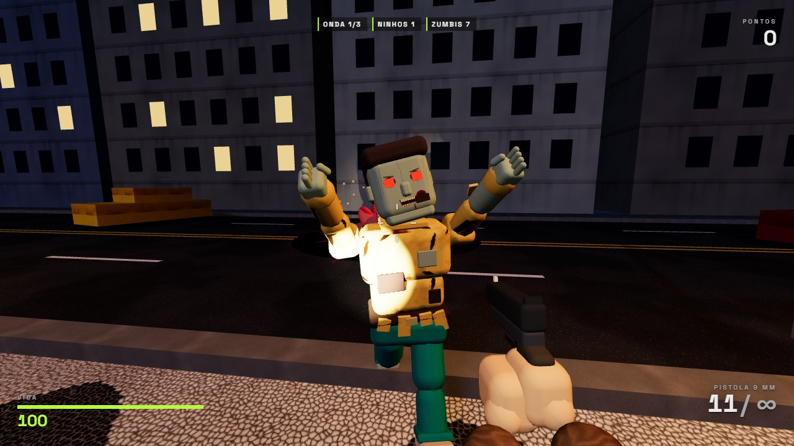
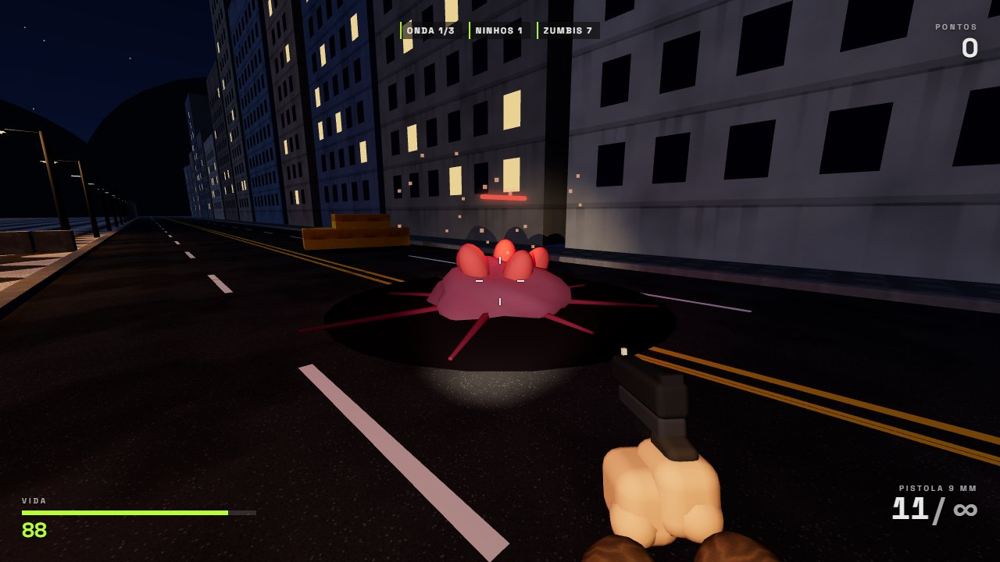
</p>

*À esquerda, o aviso do golpe: os braços erguidos dão tempo de sair do alcance, deslizar ou empurrar. À direita, um ninho na areia, que pulsa, brilha em vermelho e solta um zumbi a cada 6 a 8 s.*

## 7. Regras e consequências

Cada regra muda o que acontece na partida:

| Regra | Consequência |
| --- | --- |
| Tiro na cabeça | Dano em dobro e pontos × 1,5 |
| Combo: abates com menos de 3,5 s entre eles | Cada abate seguido soma 0,25 ao multiplicador de pontos, até × 3 |
| Levar um golpe | Perde 12 de vida e zera o combo |
| Barulho da pistola | Acorda os zumbis a até 26 m, que vêm todos de uma vez |
| Virotes contados | O virote que não é recolhido faz falta. Sem virotes, só sobra a pistola |
| Aviso do golpe | Sair do alcance, deslizar ou empurrar evita o dano |
| Ninhos | Soltam até 7 zumbis cada. Enquanto houver ninho de pé, a onda não acaba |
| Vida | Não volta sozinha: os erros se acumulam até o fim da partida |
| Zumbis com fome | O zumbi que fica muito tempo sem achar o Rafael vai atrás dele mesmo assim, para a partida não travar |

### A fase

A fase 1, em Copacabana, tem três ondas (`src/data/phases.js` e `src/systems/WaveSystem.js`). Cada onda traz um grupo de Caminhantes pelas bordas e faz brotar ninhos na orla. Para não pesar, há no máximo 12 zumbis de pé ao mesmo tempo, e os outros esperam numa fila.

| Onda | Caminhantes pelas bordas | Ninhos |
| --- | --- | --- |
| 1 | 6 | 1 |
| 2 | 8 | 2 |
| 3 | 10 | 3 |

A onda termina quando todos os ninhos caem e não sobra zumbi de pé. Entre uma onda e outra há 5 s de respiro.

## 8. Pontuação

| Evento | Pontos |
| --- | --- |
| Abater um Caminhante | 10 × multiplicador do combo |
| Abate com tiro na cabeça | × 1,5 sobre o valor acima |
| Destruir um ninho | 100 |
| Esquivar de um golpe deslizando | 5 |
| Concluir uma onda | 50 × número da onda (50, 100 e 150) |

O HUD (`src/ui/Hud.js`) mostra os pontos no alto da tela, com a barra do combo esvaziando nos 3,5 s da janela. Cada ponto ganho aparece na lista ao lado, com o motivo ("na cabeça", "ninho destruído", "esquiva"). Também ficam na tela a onda atual, os ninhos e zumbis restantes, a vida, a arma com a munição, a mira (que abre quando o Rafael corre ou atira), o marcador de acerto (branco no corpo, verde na cabeça e maior quando derruba) e a seta da direção de onde veio um golpe.

<p>
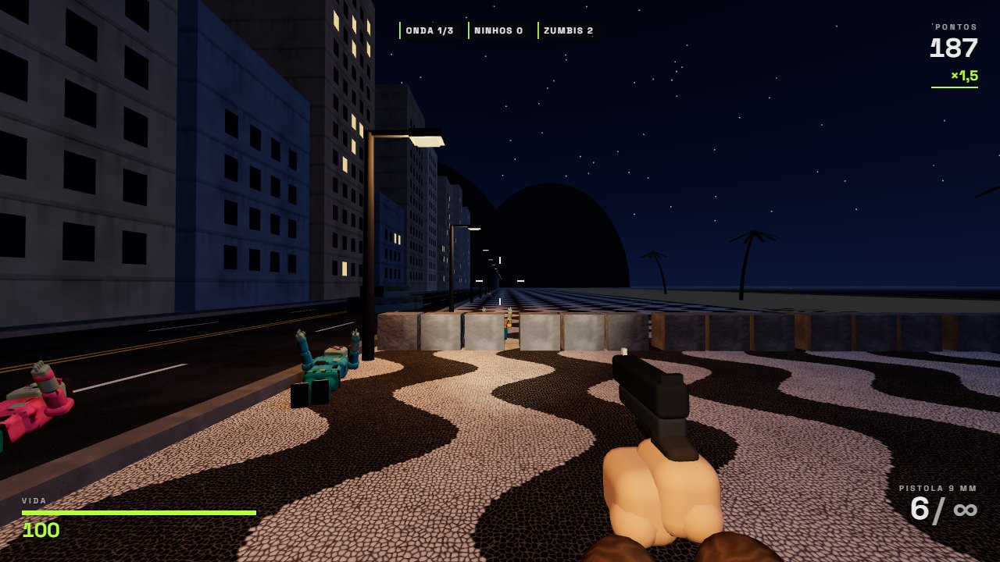
</p>

*O HUD durante a partida: onda, ninhos e zumbis no alto à esquerda, pontos e combo no centro, vida embaixo à esquerda e a arma com a munição embaixo à direita.*

## 9. Vitória, derrota e reinício

- **Vitória:** concluir as três ondas.
- **Derrota:** a vida do Rafael chegar a zero. A câmera cai até o chão antes da tela de derrota.

Nos dois casos aparece uma tela com o resultado (**"Copacabana resistiu"** ou **"O Rafael caiu"**), os pontos, o recorde e o resumo da partida: ondas concluídas, abates, tiros na cabeça, ninhos destruídos, precisão, maior combo, esquivas e tempo. O botão **Jogar de novo** (ou a tecla R) recomeça do zero, e **Menu** volta para a tela inicial. O recorde fica salvo no navegador (`localStorage`) e aparece também no menu.

<p>
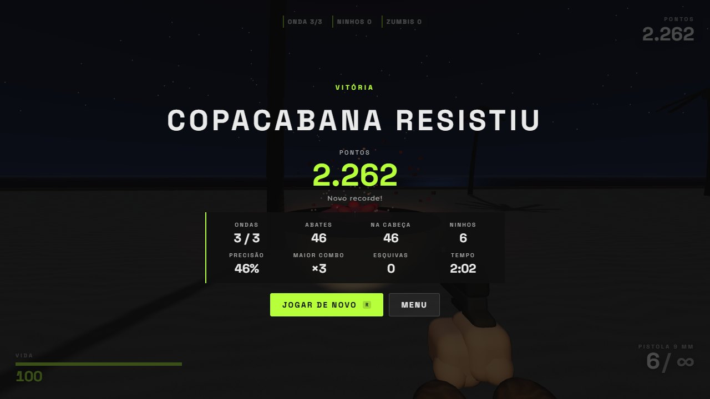
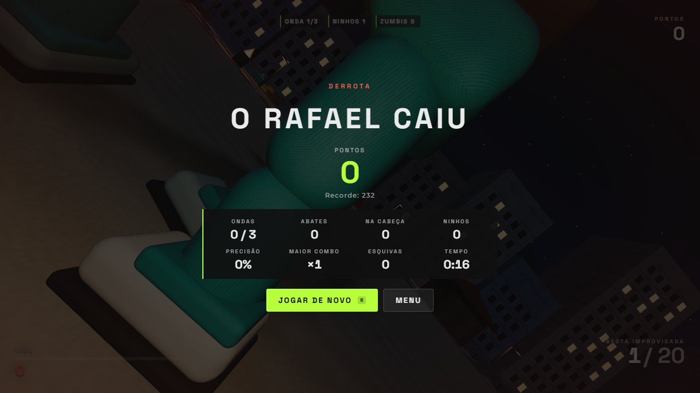
</p>

<p>
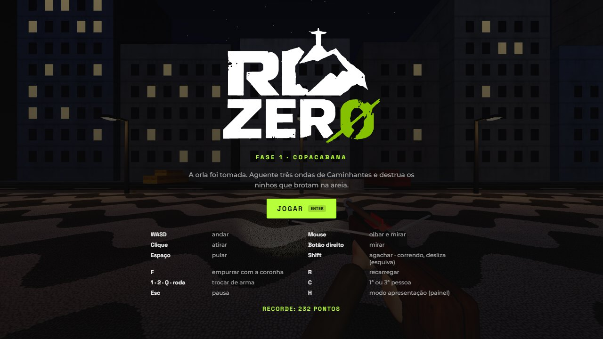
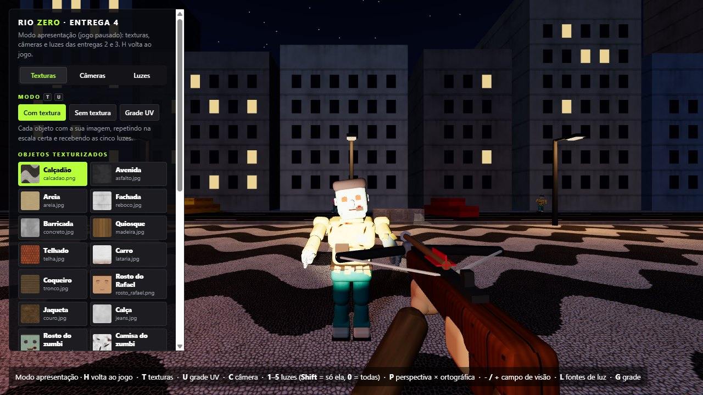
</p>

*O menu inicial, com os controles e o recorde, e o modo apresentação (tecla H), com o painel das entregas anteriores.*

## 10. Som

Todo o som é gerado em código com a Web Audio API (`src/core/Som.js`), sem nenhum arquivo de áudio. Cada som é montado com osciladores e ruído filtrado: o estalo da corda da besta, o tiro da pistola com eco, os passos (que mudam entre calçadão e areia), o gemido e o grito dos zumbis, o pulsar dos ninhos e uma música curta no começo e no fim de cada onda. Os sons do mundo são posicionados em 3D: o ouvinte é a câmera, então o gemido de um zumbi à esquerda sai do lado esquerdo. Ao fundo tocam o mar e o vento. A tecla M desliga tudo, e a escolha fica salva.

## 11. Arquivos desta entrega

| Arquivo | Situação |
| --- | --- |
| `src/core/Input.js` | Antes `src/teclado.js`. Agora também lê o mouse, com o ponteiro preso na tela |
| `src/core/CameraRig.js` | Antes `src/cameras.js`. A 1ª pessoa segue o olhar do jogador, a 3ª fica por cima do ombro e encurta quando bate numa parede |
| `src/core/Som.js` | Novo: todo o som do jogo |
| `src/entities/Player.js` | Novo: movimento, pulo, agachar, deslize, armas e ações do Rafael |
| `src/entities/Arma.js` e `modelosArmas.js` | Novos: besta e pistola, com mãos, munição, recarga e animações |
| `src/entities/Zombie.js` | Antes `src/personagens/Zumbi.js`. Visão, audição, grito, aviso do golpe, queda e roupa rasgada |
| `src/entities/Ninho.js` | Novo: o ninho que solta zumbis |
| `src/entities/Projectile.js` | Antes `src/combate.js`. Os virotes em voo, cravados e recolhidos |
| `src/entities/Humanoid.js`, `Rafael.js` e `animacao.js` | Antes em `src/personagens/`. Corpo arredondado, roupa em camadas e animação de mira |
| `src/systems/WaveSystem.js` | Novo: as ondas |
| `src/scenes/ArenaScene.js` | Novo: a fase, com as regras e a pontuação |
| `src/data/` | Novo: os números do jogo (zumbis, armas e fase) |
| `src/ui/Hud.js` | Antes `src/hud.js`. HUD, menu, pausa e telas de fim |
| `src/ui/Painel.js` | Antes `src/painel.js`. Agora abre no modo apresentação |
| `src/world/colisao.js` | Novo: colisão com o cenário |
| `src/world/Efeitos.js` | Novo: faíscas, poeira, brasas e o rastro do tiro |
| `src/world/orla.js`, `lights.js` e `texturas.js` | Antes em `src/cenario/` e `src/texturas.js`. Mesma orla, luzes e texturas |
| `src/main.js`, `index.html` e `style.css` | O fluxo da partida (menu, jogo, pausa, fim e modo apresentação) e o visual da interface |

## 12. Vídeo de demonstração

O vídeo que acompanha esta entrega mostra uma partida do começo ao fim: o menu, o movimento, cada uma das ações, o aviso do golpe, um ninho sendo destruído, o combo subindo, a passagem das ondas, a vitória, uma derrota com o reinício e, no final, o modo apresentação.

## 13. Próxima etapa

Com a partida completa, a próxima etapa amplia o jogo em volta dela: habilidades para escolher entre as ondas, mais tipos de zumbi e as próximas regiões do Rio.
